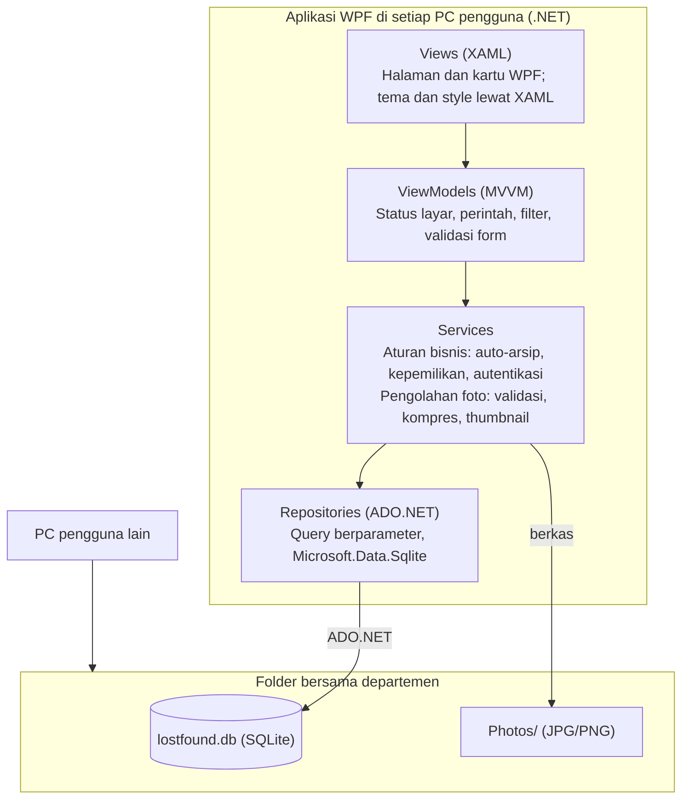
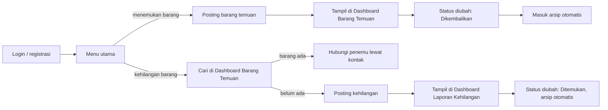

# PRD – Lost and Found Departemen Teknik Informatika

## 1. Ringkasan

**Lost and Found Departemen Teknik Informatika** adalah aplikasi desktop Windows untuk melaporkan dan mencari barang hilang dan barang temuan di lingkungan departemen. Pengguna memposting barang temuan atau kehilangan, mencarinya lewat dua dashboard terpisah, lalu menandai selesai sehingga posting masuk arsip otomatis. Antarmukanya dirancang dengan pendekatan Rich UI: visual, interaktif, dan mudah dipakai.

## 2. Arsitektur & Tech Stack

Aplikasi berlapis dengan prinsip MVVM: Views, ViewModels, Services, dan Repositories; semua PC memakai satu database SQLite dan satu folder foto bersama.

| Komponen | Teknologi | Fungsi |
| --- | --- | --- |
| Bahasa dan runtime | C#, .NET | Bahasa dan platform aplikasi |
| Antarmuka | WPF + XAML | Jendela, halaman, dan data binding |
| Akses data | ADO.NET (Microsoft.Data.Sqlite) | Query berparameter dan transaksi, tanpa ORM |
| Database | SQLite (berkas `lostfound.db`) | Menyimpan akun dan posting |
| Penyimpanan foto | Folder `Photos/` | Berkas JPG/PNG; database hanya menyimpan path |
| Keamanan kata sandi | PBKDF2 bawaan .NET | Kata sandi disimpan sebagai hash |

Catatan: Agar dashboard menampilkan posting orang lain, database dan folder foto ditaruh di folder bersama yang bisa diakses semua PC.

### 2.1 Pola Arsitektur: MVVM

Aplikasi menerapkan MVVM (Model-View-ViewModel) agar tampilan terpisah dari logika dan mudah dirawat.

| Bagian | Peran | Contoh di aplikasi |
| --- | --- | --- |
| Model | Data dan logika bisnis | `User`, `FoundItem`, `LostItem`, Services, Repositories |
| View | Tampilan XAML, tanpa logika bisnis | Jendela utama, Dashboard, Form Posting, Detail Posting |
| ViewModel | Status layar dan perintah (command) yang diikat ke View | `LoginViewModel`, `FoundDashboardViewModel`, `LostDashboardViewModel`, `PostFormViewModel`, `MyPostsViewModel` |

Aturan penerapan:

- View terhubung ke ViewModel lewat **data binding**; saat data atau filter berubah, tampilan ikut diperbarui otomatis.
- ViewModel tidak mengenal View dan tidak membuka jendela atau dialog secara langsung.
- Code-behind View hanya berisi kode khusus tampilan; validasi dan aturan bisnis berada di ViewModel dan Services.
- Akses database hanya lewat Repositories, tidak pernah langsung dari ViewModel atau View.

## 3. Peran Pengguna

| Peran | Kemampuan |
| --- | --- |
| User | Registrasi dan login; memposting, mengedit, menghapus, dan mengubah status posting miliknya; melihat dashboard dan detail posting orang lain |
| Admin | Semua kemampuan User, ditambah **takedown** posting yang melanggar ketentuan. Tidak ada fitur admin lain. Akun Admin dibuat lewat data awal database. |

### 3.1 Daftar Use Case

Admin dapat menjalankan semua use case User, ditambah UC-16.

| ID | Use Case | Aktor | Deskripsi |
| --- | --- | --- | --- |
| UC-01 | Registrasi akun | User | Mendaftar dengan nama lengkap, NIM/NIP, dan kata sandi |
| UC-02 | Login | User, Admin | Masuk ke aplikasi dengan NIM/NIP dan kata sandi |
| UC-03 | Logout | User, Admin | Keluar dari sesi aplikasi |
| UC-04 | Memposting barang temuan | User | Mengisi form barang temuan (nama, foto, kategori, lokasi, tanggal, deskripsi, kontak) |
| UC-05 | Memposting kehilangan barang | User | Mengisi form kehilangan (foto dan lokasi opsional) |
| UC-06 | Mengedit posting sendiri | User | Mengubah isi posting aktif miliknya |
| UC-07 | Menghapus posting sendiri | User | Menghapus posting miliknya setelah konfirmasi |
| UC-08 | Mengubah status posting | User | Menandai Dikembalikan atau Ditemukan; posting otomatis masuk arsip |
| UC-09 | Mengembalikan posting dari arsip | User | Mengaktifkan kembali posting miliknya yang salah diarsipkan |
| UC-10 | Melihat Dashboard Barang Temuan | User | Melihat daftar kartu barang temuan aktif dari semua pengguna |
| UC-11 | Mencari dan memfilter barang temuan | User | Mencari kata kunci; filter kategori, lokasi, dan rentang tanggal; mengurutkan |
| UC-12 | Melihat Dashboard Laporan Kehilangan | User | Melihat daftar laporan kehilangan aktif dari semua pengguna |
| UC-13 | Mencari dan memfilter laporan kehilangan | User | Mencari kata kunci; filter kategori, lokasi, dan rentang tanggal; mengurutkan |
| UC-14 | Melihat detail posting | User | Membuka detail lengkap posting beserta foto dan kontak |
| UC-15 | Melihat Posting Saya dan arsip | User | Melihat posting pribadi, tab Aktif dan Arsip, untuk Temuan dan Kehilangan |
| UC-16 | Takedown posting | Admin | Menghapus posting yang melanggar ketentuan beserta fotonya |

## 4. Spesifikasi Fitur

### 4.1 Akun

- Registrasi: nama lengkap, NIM/NIP (unik), kata sandi (minimal 8 karakter).
- Login dengan NIM/NIP dan kata sandi; logout dari menu.

### 4.2 Posting Barang Temuan

| Field | Wajib | Keterangan |
| --- | --- | --- |
| Nama barang | Ya | Teks singkat |
| Foto barang | Ya | JPG/PNG, maksimal 5 MB |
| Kategori | Ya | Pilih dari daftar kategori |
| Lokasi ditemukan | Ya | Teks bebas |
| Tanggal ditemukan | Ya | Tidak boleh di masa depan |
| Deskripsi singkat | Ya | Maksimal 300 karakter |
| Kontak yang bisa dihubungi | Ya | Nomor WhatsApp, email, atau lainnya |
| Status | Otomatis | "Belum Dikembalikan"; jika diubah ke "Dikembalikan", posting otomatis masuk arsip |

### 4.3 Posting Kehilangan Barang

| Field | Wajib | Keterangan |
| --- | --- | --- |
| Nama barang | Ya | Teks singkat |
| Foto barang | Tidak | JPG/PNG, maksimal 5 MB |
| Kategori | Ya | Pilih dari daftar kategori |
| Lokasi kehilangan | Tidak | Teks bebas |
| Tanggal kehilangan | Ya | Tidak boleh di masa depan |
| Deskripsi kehilangan | Ya | Ciri-ciri barang dan kronologi singkat |
| Kontak yang bisa dihubungi | Ya | Nomor WhatsApp, email, atau lainnya |
| Status | Otomatis | "Belum Ditemukan"; jika diubah ke "Ditemukan", posting otomatis masuk arsip |

### 4.4 Edit dan Hapus Posting

- Pemosting dapat **mengedit** semua field posting aktif miliknya, dan **menghapus** posting miliknya setelah konfirmasi.
- Perubahan status dilakukan oleh pemosting dari halaman detail atau Posting Saya.
- Posting di arsip tidak bisa diedit; pemosting dapat mengembalikannya ke aktif bila salah ubah status.

### 4.5 Dashboard Barang Temuan

- Menampilkan posting temuan **aktif** dari semua pengguna dalam bentuk kartu (foto, nama, kategori, lokasi, tanggal).
- Pencarian teks pada nama barang, deskripsi, dan lokasi.
- Filter: kategori, rentang tanggal ditemukan, dan lokasi; bisa digabung dan direset.
- Urutan: terbaru atau terlama. Klik kartu membuka halaman detail lengkap beserta kontak.

### 4.6 Dashboard Laporan Kehilangan

- Dashboard terpisah berisi laporan kehilangan **aktif** dari semua pengguna.
- Pencarian pada nama barang dan deskripsi; filter kategori, rentang tanggal kehilangan, dan lokasi.
- Tampilan dan urutan sama dengan Dashboard Barang Temuan; foto hanya tampil bila ada.

### 4.7 Posting Saya dan Arsip

- Halaman berisi posting milik sendiri dengan tab Temuan dan Kehilangan, masing-masing dengan sub-tab Aktif dan Arsip.
- Arsip hanya terlihat oleh pemosting dan tidak tampil di dashboard.

### 4.8 Takedown oleh Admin

- Admin melihat tombol **Takedown** pada halaman detail posting siapa pun.
- Takedown menghapus posting dan fotonya secara permanen setelah konfirmasi.
- Ini satu-satunya fitur khusus Admin.

### 4.9 Kategori dan Aturan Umum

- Kategori tetap: Dompet & Kartu, Elektronik, Kunci, Tas, Pakaian, Alat Tulis & Buku, Dokumen, Lainnya.
- Hanya pemosting (dan Admin untuk takedown) yang dapat mengubah atau menghapus sebuah posting; aturan ini diperiksa di kode, bukan hanya disembunyikan di tampilan.
- Isi kontak minimal 5 karakter. Kontak hanya tampil di halaman detail untuk pengguna yang sudah login.
- Foto dikompres dan diganti nama dengan GUID saat disimpan.

## 5. Alur Pengguna

Penemu langsung memposting barang. Orang yang kehilangan lebih dulu mencari di Dashboard Barang Temuan; jika belum ada, ia memposting laporan kehilangan. Keduanya mengubah status di akhir sehingga posting masuk arsip.

## 6. Model Data (SQLite)

**Users**

| Kolom | Tipe | Keterangan |
| --- | --- | --- |
| Id | INTEGER | PK, autoincrement |
| IdentityNumber | TEXT | NIM/NIP, unik |
| FullName | TEXT | Nama lengkap |
| PasswordHash, PasswordSalt | TEXT | Hash PBKDF2 dan salt |
| Role | TEXT | 'User' atau 'Admin' |

**FoundItems** (barang temuan)

| Kolom | Tipe | Keterangan |
| --- | --- | --- |
| Id | INTEGER | PK, autoincrement |
| UserId | INTEGER | FK ke Users |
| ItemName | TEXT | Wajib |
| PhotoPath | TEXT | Wajib |
| Category | TEXT | Salah satu kategori tetap |
| Location | TEXT | Lokasi ditemukan, wajib |
| FoundDate | TEXT | Format YYYY-MM-DD |
| Description | TEXT | Maksimal 300 karakter |
| Contact | TEXT | Wajib |
| Status | TEXT | 'BelumDikembalikan' atau 'Dikembalikan' (arsip) |
| CreatedAt, UpdatedAt | TEXT | Waktu dibuat dan diubah |

**LostItems** (kehilangan barang)

| Kolom | Tipe | Keterangan |
| --- | --- | --- |
| Id | INTEGER | PK, autoincrement |
| UserId | INTEGER | FK ke Users |
| ItemName | TEXT | Wajib |
| PhotoPath | TEXT | Boleh kosong |
| Category | TEXT | Salah satu kategori tetap |
| Location | TEXT | Lokasi kehilangan, boleh kosong |
| LostDate | TEXT | Format YYYY-MM-DD |
| Description | TEXT | Wajib |
| Contact | TEXT | Wajib |
| Status | TEXT | 'BelumDitemukan' atau 'Ditemukan' (arsip) |
| CreatedAt, UpdatedAt | TEXT | Waktu dibuat dan diubah |

Dashboard hanya memuat baris dengan status belum selesai; arsip adalah baris dengan status selesai. Semua query memakai parameter ADO.NET.

## 7. Layar Aplikasi

| Layar | Isi |
| --- | --- |
| Login / Registrasi | Form NIM/NIP dan kata sandi |
| Dashboard Barang Temuan | Pencarian, filter, kartu barang temuan aktif |
| Dashboard Laporan Kehilangan | Pencarian, filter, kartu laporan kehilangan aktif |
| Detail Posting | Foto, semua field, kontak; tombol Edit, Ubah Status, Hapus untuk pemilik; tombol Takedown untuk Admin |
| Form Posting | Satu form untuk Temuan dan Kehilangan, dipakai juga untuk edit |
| Posting Saya | Tab Temuan / Kehilangan, sub-tab Aktif / Arsip |

Navigasi memakai menu di sisi kiri; pesan sukses dan gagal tampil sebagai snackbar, dan aksi hapus selalu meminta konfirmasi.

## 8. Kebutuhan Non-Fungsional

- Berjalan di Windows 10/11 (64-bit) dengan antarmuka Bahasa Indonesia.
- Dashboard tetap responsif: pembacaan database dan pemuatan foto dilakukan asinkron.
- Dirancang untuk skala departemen (ribuan posting); pencarian memakai `LIKE`.
- Aktifkan `PRAGMA foreign_keys` dan `busy_timeout` agar penulisan bersamaan tidak langsung gagal.