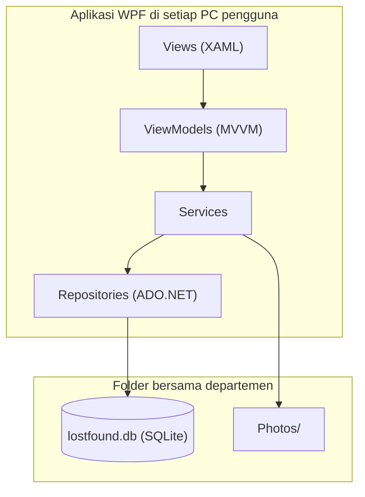

# Lost and Found Departemen Teknik Informatika

Aplikasi desktop Windows untuk melaporkan dan mencari **barang temuan** dan **barang hilang** di lingkungan Departemen Teknik Informatika. Posting yang sudah selesai (barang dikembalikan atau ditemukan) otomatis masuk arsip. Antarmukanya dirancang dengan pendekatan Rich UI: visual, interaktif, dan mudah dipakai.

> Spesifikasi lengkap ada di [PRD.md](PRD.md).

## Fitur

- **Posting barang temuan**: nama, foto, kategori, lokasi, tanggal, deskripsi singkat, kontak, status Dikembalikan / Belum.
- **Posting kehilangan**: nama, foto (opsional), kategori, lokasi (opsional), tanggal, deskripsi, kontak, status Ditemukan / Belum.
- **Edit dan hapus** posting milik sendiri; ubah status untuk mengarsipkan posting.
- **Dua dashboard terpisah** (Barang Temuan dan Laporan Kehilangan) dengan pencarian teks dan filter kategori, lokasi, dan rentang tanggal.
- **Posting Saya**: daftar posting pribadi dengan tab Aktif dan Arsip.
- **Admin**: hanya dapat melakukan *takedown* (menghapus posting yang melanggar ketentuan).

## Use Case

Admin dapat menjalankan semua use case User, ditambah UC-16.

| ID | Use Case | Aktor |
| --- | --- | --- |
| UC-01 | Registrasi akun | User |
| UC-02 | Login | User, Admin |
| UC-03 | Logout | User, Admin |
| UC-04 | Memposting barang temuan | User |
| UC-05 | Memposting kehilangan barang | User |
| UC-06 | Mengedit posting sendiri | User |
| UC-07 | Menghapus posting sendiri | User |
| UC-08 | Mengubah status posting (arsip otomatis) | User |
| UC-09 | Mengembalikan posting dari arsip | User |
| UC-10 | Melihat Dashboard Barang Temuan | User |
| UC-11 | Mencari dan memfilter barang temuan | User |
| UC-12 | Melihat Dashboard Laporan Kehilangan | User |
| UC-13 | Mencari dan memfilter laporan kehilangan | User |
| UC-14 | Melihat detail posting | User |
| UC-15 | Melihat Posting Saya dan arsip | User |
| UC-16 | Takedown posting | Admin |

## Tech Stack

| Komponen | Teknologi |
| --- | --- |
| Bahasa dan runtime | C#, .NET |
| Antarmuka | WPF + XAML |
| Akses data | ADO.NET (Microsoft.Data.Sqlite) |
| Database | SQLite |
| Penyimpanan foto | Folder `Photos/` |

## Arsitektur



Semua PC membaca dan menulis database dan folder foto yang sama, sehingga dashboard menampilkan posting dari pengguna lain.

### Pola MVVM

Aplikasi menerapkan MVVM (Model-View-ViewModel):

| Bagian | Peran | Contoh |
| --- | --- | --- |
| Model | Data dan logika bisnis | `User`, `FoundItem`, `LostItem`, Services, Repositories |
| View | Tampilan XAML, tanpa logika bisnis | Jendela utama, Dashboard, Form Posting, Detail Posting |
| ViewModel | Status layar dan perintah yang diikat ke View | `LoginViewModel`, `FoundDashboardViewModel`, `LostDashboardViewModel`, `PostFormViewModel`, `MyPostsViewModel` |

- View terhubung ke ViewModel lewat data binding.
- ViewModel tidak mengenal View.
- Akses database hanya lewat Repositories.

## Prasyarat

- Windows 10/11 (64-bit)
- [.NET 10 SDK](https://dotnet.microsoft.com/download/dotnet/10.0)
- Visual Studio 2026 atau JetBrains Rider terbaru (opsional; Visual Studio 2022 tidak mendukung .NET 10)

## Menjalankan

```bash
git clone https://github.com/<username>/<nama-repo>.git
cd <nama-repo>
dotnet restore
dotnet run --project LostFound.App
```

Pada saat pertama dijalankan, aplikasi membuat berkas `lostfound.db` dan folder `Photos/`. Lokasi keduanya dapat diarahkan ke folder bersama lewat `appsettings.json`:

```json
{
  "DatabasePath": "\\\\SERVER\\LostFound\\lostfound.db",
  "PhotosPath": "\\\\SERVER\\LostFound\\Photos",
  "AdminIdentityNumber": "admin",
  "AdminFullName": "Administrator",
  "AdminPassword": "admin12345"
}
```

Path relatif dihitung dari folder aplikasi. Akun Admin dibuat dari data awal (seed) database saat database belum memiliki Admin. Akun bawaannya NIM/NIP `admin` dengan kata sandi `admin12345`; ubah nilai `Admin*` di `appsettings.json` sebelum aplikasi pertama kali dijalankan di folder bersama.

## Struktur Proyek

```
LostFound.sln
├─ LostFound.App/     WPF: App.xaml, Views/, Styles/, ViewModels/
├─ LostFound.Core/    Models/, Services/, Validation/
└─ LostFound.Data/    Repositories/, skrip SQL skema
```

## Kategori Barang

Dompet & Kartu, Elektronik, Kunci, Tas, Pakaian, Alat Tulis & Buku, Dokumen, Lainnya.

## Lisensi

Tentukan lisensi sebelum repositori dipublikasikan (misalnya MIT).